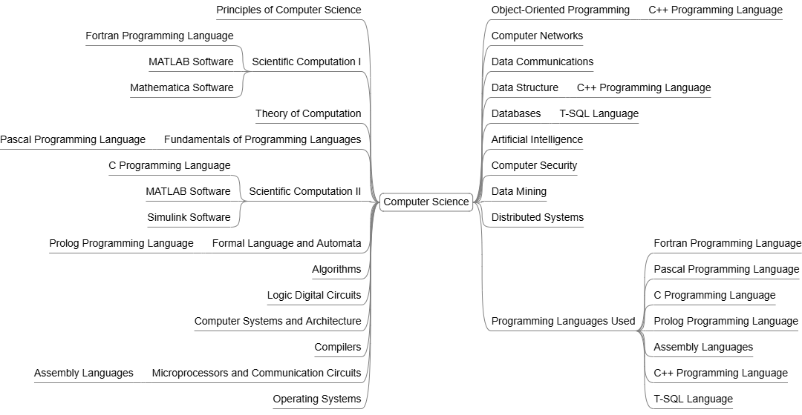

# Computer Science Courses

The core discipline of the curriculum, covering Computation Theory, Computer Systems & Architecture, Programming & Software Development, Algorithms & Data Structures, Databases & Data Management, Computer Networks, Artificial Intelligence, and other foundational areas of computing.

## Principles of Computer Science

- Computer Fundamentals
- Computer Systems Fundamentals
- Data Representation and Binary System
- Algorithms and Problem Solving Fundamentals
- Programming languages Fundamentals
- Procedural programming languages
- Elements of Language under case
- Basic Instructions in Language under case
- Data and Information
- Computer applications

## Scientific Computation I

- Practical introduction to computational problem solving
- Floating point arithmetic, conditioning and stability of algorithms
- Spreadsheets programs
- Methods of Random numberData and Information generators
- Some problems in Computational mathematics
- Some problems in Computational physics
- Interval Computation
- Methods for computational fluid dynamics
- Mathematical software packages; MATLAB, Mathematica
- Programming Languages; FORTRAN

## Theory of Computation

- Models of computers including finite automata and Turing machines
- Basics of formal languages with applications to the syntax of programming languages
- Alternate characterizations of language classes
- Proving unrecognizability
- Unsolvable problems and their relevance to the semantics of programming

## Fundamentals of Programming Languages

- Levels of Syntax 
- Binding and Scope 
- Static and Dynamic Semantics 
- Data Types and Variables
- Expressions and Assignment Statements
- Control Structures
- Recursion, Iteration, Fixed Points
- Arrays
- Functions, Procedures
- Records, Sets, Variants
- Subprograms
- Programming Languages; Pascal

## Scientific Computation II

- Computational problem solving
- Monte Carlo simulation
- Continuous Simulation
- Discrete System Simulation
- Soft Computing
- Genetic and evolutionary algorithms
- Neural Networks
- Granular Computing, and swarm intelligence
- Methods of cryptography
- Basic techniques of system performance evaluation
- Verification and validation of simulation models
- Analysis of simulation output
- modeling of computer systems, networks, and other queuing or non-queuing systems
- Software packages; MATLAB, Simulink
- Programming Languages; Pascal

## Formal Language and Automata

- Alphabets and languages. 
- Finite representation of language. 
- Deterministic and non- deterministic finite automata and their applications. 
- Equivalence considerations 
- Regular expressions. 
- Context-free languages  
- Regular languages, pushdown automata. 
- Properties of context-free languages. 
- Determinism and parsing top down parsing and bottom-up parsing
- Computing with Turing machines
- Combining Turing machines
- Nondeterministic Turing machines
- Programming Languages; Prolog

## Algorithms

- Divide and conquer algorithms
- recurrences
- greedy algorithms
- dynamic programming
- graph search 
- NP-completeness and its implications
- randomized algorithms
- amortized analysis
- lower bounds approximation algorithms
- on-line algorithms
- applications

## Logic Digital Circuits

- Basic logic concepts
- Combinational logic
- Multiplexers and de multiplexers, encoders, decoders, adders and subtractors 
- Look-ahead carry 
- Comparators 
- Programmable logic arrays and memories 
- Design with MSI, logic families, tri-state devices, CMOS and TTL logic interfacing 
- Sequential logic 
- Analog and digital conversion 
- Data acquisition 
- Microprocessors

## Computer Systems and Architecture

- Design of a basic computer
- Design concepts of Processors
- Design of channels and controllers
- Interconnections
- Memory structures and design
- Memory management
- Cache memory systems
- Firmware design
- Reliability
- Testing and fault tolerance
- CISC computers
- RISC computers
- Computer interfacing
- Design of network interface cards
- Examples of computer architecture

## Compilers

- Lexical analysis
- Syntactic analysis
- Recursive descent parsing
- LR parsing
- Syntax-directed translation
- Type checking
- Run-time environments
- Code generation
- Code optimization
- Various language design issues

## Microprocessors and Communication Circuits

- x86 Processor Architecture
- Memory management
- I/O System
- Instruction Sets
- Assembling, Linking and Running programs
- Defining data
- Symbolic constants
- Programming Languages; Assembly

## Operating Systems

- Introduction to function, design, and implementation of operating system
- co-ordination and synchronization processes
- scheduling and dispatch
- physical and virtual memory organization
- paging and segmentation
- device management
- file systems
- security and protection
- communications and networking
- distributed systems

## Object Oriented Programming

- Concepts of object-oriented programming
- Classes and Objects
- Interfaces
- Dynamic dispatch/message passing
- Class-based versus prototype-based
- Encapsulation
- Composition, inheritance, and delegation
- Polymorphism
- Open recursion
- Programming Languages; C++

## Computer Networks

- Network architectures and protocols
- placing emphasis on protocols used in the Internet
- application layer protocols
- network programming
- transport protocols, routing, multicast; 
- data link layer issues
- multimedia networking
- network security
- network management
- Simulation of the network/transport layer functions, routing, congestion control
- Ethernet controller
- applications using TCP/IP or remote procedure calls

## Data Communications

- Network architectures and topology 
- Communication protocols and interfaces
- Functional layers
- Transmission facilities including communications equipment, line utilization, switching, and error handling
- Standard protocols
- Network interfaces including routing and flow control

## Data structures

- Data representation
- arrays and matrices 
- lists  stacks and queues 
- hashing 
- binary trees, balanced and B-trees 
- splay trees and tree traversals using stacks 
- expression trees 
- expressions and conversions 
- graphs, graph algorithms 
- minimum-cost  spanning trees 
- inheritance 
- exceptions,  interface and design by contract 
- basic design patterns and reuse
- Programming Languages; C++

## Databases

- Introduction to Database System
- Operational Data
- Data independence
- Relational System
- The architecture of DB System
- Relational Algebra and Calculus
- Recovery and concurrence
- Security and integrity
- Programming Languages; T-SQL Language

## Artificial Intelligence

- Goals and methods of artificial intelligence
- Methods of general problem solving
- Mathematical logic
- Mechanical theorem proving
- Game playing
- Natural language processing

## Computer Security

- Overview
- characteristics of computer intrusion
- points of security vulnerability
- methods of defense
- Basic encryption and decryption
- different types of ciphers
- characteristic of good ciphers
- Security involving programs
- database security
- reliability and integrity
- sensitive data
- the inference problem 
- multilevel data security
- Cryptography

## Data Mining

- Data Mining Overview
- Data Warehouse
- Data Preprocessing
- Classification
- Clustering
- Prediction
- Logistic Regression
- Association Rules

## Distributed Systems

- Parallel and Distributed Architecture
- Parallel Algorithm design
- Message-passing Programming
- Sharing-memory Programming
- Performance analysis
- Applications

## Programming Languages

- Fortran Programming Language (Scientific Computation I Course)
- Pascal Programming Language (Fundamentals of Programming Languages Course)
- C Programming Language (Scientific Computation II Course)
- Prolog Programming Language (Formal Language and Automata Course)
- Assembly Language (Microprocessors and Communication Circuits Course)
- C++ Programming Language (Object-Oriented Programming, Data Structure Courses)
- T-SQL Language (Databases Course)