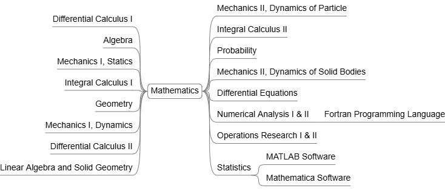

# Mathematics Courses

A collection of mathematics courses that provide the theoretical and analytical foundation for computer science.

## Differential & Integral Calculus I 

- Functions of one variable
- Limits and Continuity
- Derivatives
- Applications of Differentiation
- Taylor and McLauren series
- Indefinite and definite integrals
- Improper integral
- Numerical integration
- Techniques of integration
- Definite integrals and their properties
- Applications of definite integrals

## Algebra

- Mathematical induction
- Series
- Partial fractions
- Matrices and systems of linear equations
- Approximate solutions of non-linear equations

## Geometry

- Coordinate systems in the plane
- Straight lines and circles in general forms
- Conic sections
- Geometric transformations in the plane
- Coordinate systems in the space
- The plane and the straight lines in the space
- surfaces of revolution of second order
- Quadric Surfaces
- Ruled Surfaces

## Newtonian Mechanics

- Statics in plane
- Application on equilibrium of 2D Force Systems
- Statics in space
- Friction
- Center of gravity and centroid
- Virtual work
- Kinematic of a particle in a straight line
- Kinematic of a particle in a plane
- Relative motion in plane
- Kinetics of a particle
- Simple harmonic motion
- Projectile motion
- Dynamics of rigid body in a plane

## Analytical Mechanics

- Dynamics of a particles in 3D Dimensions
- Rotating Axes
- Component of velocity and acceleration in different coordinate systems
- Foucault’s pendulum
- Dynamic of rigid body in three dimensions
- Eulerian angles
- Moment on inertia
- Equation of motion of rigid body
- Euler equations
- Generalized coordinate
- Lagrange Equations
- Hamilton functions
- Routh Equations
- Sturm–Louwville equation
- Invariants
- Hamilton–Jacobi equation

## Differential & Integral Calculus II (Advanced Calculus)

- Functions of several real variables
- Partial Derivatives and their applications
- Maxima and minima
- Multiple integrals (double – triple) and their applications
- Line and Surface integrals
- Using Mathematica, and Matlab programs for graphing some Surfaces and calculate some integrals

## Linear algebra & Solid geometry

- Vector Spaces
- Linear Transformations
- Properties of linear transformations (range and kernel)
- Algebra of linear transformations
- Eigenvalues and Eigenvectors
- Inner product spaces
- Self adjoint transformations Bilinear and quadratic forms
- Reduction of quadratic forms in Rn
- Applications in Geometry

## Probability

- Sample Space
- Random Variables
- Some Discrete distributions
- Some Continuous distributions
- Bivariate and multivariate random variables
- Some special Bivariate distributions
- Conditional probability and distribution functions 
- Independence of random variables
- Expectation of functions of two variables
- Conditional expectation
- Correlation and moment generating function in more than one variable
- Bivariate normal
- Distributions of functions of random variables

## Differential Equations

- Formation of ordinary differential equations(ODE’S)
- ODE’S of first order and first degree
- ODE’S of first order and higher degrees
- Applications
- Linear ODE’S of higher orders with constant coefficients and its applications
- Linear ODE’S of higher orders with variant coefficients
- Partial differential equations
- Simultaneous Linear  ODE's.

## Numerical Analysis I & II

- Errors in Numerical Computations
- Solutions of Non-Linear equations
- Direct Methods for solving linear systems
- Iterative Methods for solving linear systems
- Interpolation and Polynomial Approximations
- Numerical differential
- Numerical Integration
- Iterative methods for linear system
- Approximation theory
- Eigenvalues
- Numerical solutions of the initial value problems
- Numerical solutions of the boundary value problems
- Numerical solutions of partial differential equations
- Using Fortran Programming Language

## Operations Research I & II

- Standard form of the Linear Programming Problems (LPPs)
- Methods for solving LPPs
- Sensitivity analysis
- Network flow problems
- Integer programming
- Shortest path problems
- Decision Analysis
- Classical optimization techniques
- Numerical methods for unconstrained and constrained optimization problems
- Calculus of variation
- Optimal control problems
- Pontriagen's maximums principals
- Bellman's dynamic programming

## Statistics

- Random number generation and Monte Carlo methods
- Regression computations and application Simulation techniques
- Basic likelihood tools
- Fundamental principles of modeling
- Bayesian computation techniques
- Statistical Distributions
- Sampling distributions
- Point Estimation
- Interval Estimation
- Hypothesis Testing
- Reliability Theory
- Using the mathematical and statistical packages (MATLAB, Mathematica) for matrices
- Using the mathematical and statistical packages for Functions, Graphics and Data Fitting
- Using the mathematical and statistical packages for Applied Statistics