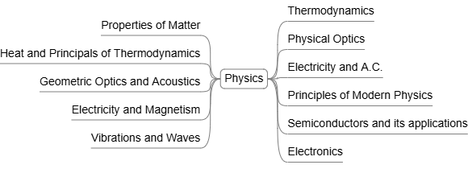

# Physics Courses

A collection of Physics courses that strengthen scientific reasoning and provide the physical foundations relevant to computing technologies.

## General Physics & Properties of Matter

- Physical quantity
- Units and dimensional analysis
- The laws of motion in one and two dimensions and its applications
- Internal Forces
- Elasticity
- Tensile Stress and Strain
- Compressive Stress and Strain
- Volume Change: Bulk Modulus
- Shearing Stress and Strain
- Cohesion and Adhesion
- Surface Tension
- Pressure and Curved Surfaces
- Capillarity
- Work and energy
- Toughness
- Viscosity

## Electricity and Magnetism

- Coulomb law and electrostatic fields
- Electrostatic potential
- Capacitance and dielectrics
- Electric current and DC circuits
- Krichhoff’s Rules
- Magnetic field and magnetic force
- Electromagnetic induction

## Heat & Thermodynamics

- Work and energy
- Heat and heat conduction
- The kinetic theory of gases
- Specific heat of gases
- Thermodynamics definitions
- The 1st law of thermodynamics
- Adiabatic and isothermal process
- Heat engine and Camot's cycle
- The 2°- law of thermodynamics
- The entropy and thermodynamic potential
- Important thermodynamic relations
- Applications on Maxwell's equations
- The 3-law of thermodynamics
- The principles of gas liquefaction. 

## Geometrical optics and Acoustics

- The nature and propagation of light
- Reflection and refraction at plane surface
- Lenses and Mirrors
- Eye’s structure and camera
- Microscopes and Telescopes
- Doppler effect

## Electricity and Alternating current

- RL and RC Circuits and Stored energy
- RLC Circuit under different conditions (over damped, critically damped and oscillatory damped circuits)
- RC and RL circuits analyses
- Analyses of AC circuits in terms of complex numbers
- Power of AC circuits
- AC transient current for RL, RC and RLC circuits

## Physical Optics

- Waves motion and superposition
- Interference of light waves
- Interference Pattern from double slits (Young's experiment)
- Interference of light in thin films 
- Diffraction of light waves 
- Single and double slits diffraction 
- The diffraction grating, resolving power of the diffraction grating 
- X-rays diffraction by crystals 
- Polarization of light waves, optical activity. Laser definitions

## Vibration and Waves

- The simple harmonic motion 
- The simple harmonic motion in mechanical and electrical systems
- The damped oscillation in mechanical and electrical systems
- The forced damped oscillation in mechanical and electrical systems
- Summation of the simple harmonic motions in two dimensions
- Types of the waves, reflection and transmission of the waves
- Theultrasonic waves
- Doppler's effect

## Principles of Modern physics

- Nature and characteristics of modem physics 
- Black-body radiation, Planck's law of radiation, photo-electric effect 
- The Hydrogen atom
- Rutherford model of the atom 
- Bohr's theory , Sommerfeld's theory of elliptic orbits 
- Compton effect 
- Dual nature of matter, De Broglie waves
- Heisenberg's uncertainty principle 
- Galilean and Lorentz transformations 
- Michelson-Morley experiment, Doppler effect 
- Special theory of relativity

## Solid-state physics

- Crystal structure  
- Reciprocal lattice
- X-ray diffraction in crystals
- Lattice vibrations and thermal properties
- Elastic waves in crystals, elastic strains
- Defects in solids (point defects & dislocations)
- The free electron model and electrical properties
- Energy bands in solids, Brillouin zones
- Theory of the dielectrics Optical properties of solids 
- Magnetic properties of solids

## Semiconductors

- Crystal structure
- Energy brands
- Intrinsic and extrinsic semiconductors
- Fermi-Dirac Function
- Density of carriers
- Carrier Transport
- Hall effect
- P-N Junctions
- I-V and C-V Characteristics
- Characteristics of Transistors (BJT, MIS)
- Optoelectronic : photodiodes, laser diodes, solar cells 

## Electronics

- Semiconductor diode and applications
- Bipolar junction transistors
- Field-effect transistors
- Biasing of transistors
- Integrated circuits
- Operational amplifiers
- Feedback amplifiers
- oscillators