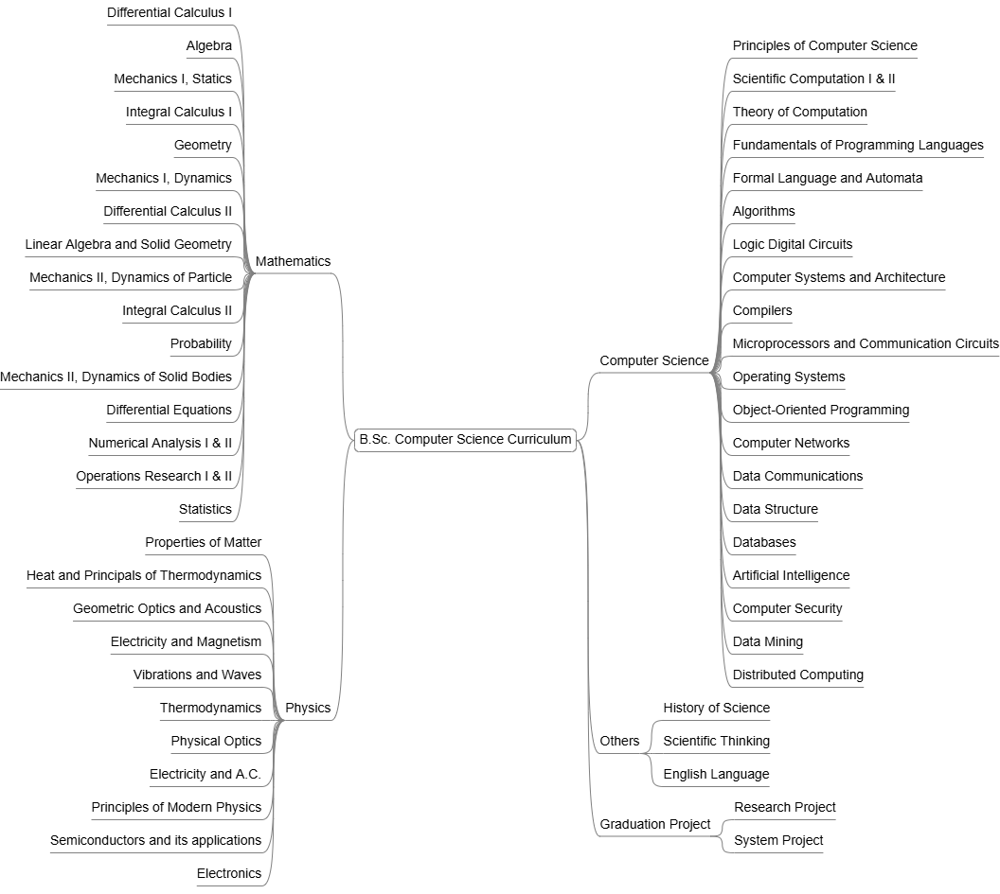

# AUN B.Sc. in Computer Science Program

Assiut University — Bachelor of Science (B.Sc.) in Computer Science Program

The original B.Sc. in Computer Science program as studied at university, representing the academic foundation of my computer science education. The curriculum is organized into three main categories: Mathematics, Physics, and Computer Science courses.

## [Mathematics](Math/README.md)

* 01- Differential Calculus I
* 02- Algebra
* 03- Mechanics I, Statics
* 04- Integral Calculus I
* 05- Geometry
* 06- Mechanics I, Dynamics
* 07- Differential Calculus II
* 08- Linear Algebra and Solid Geometry
* 09- Mechanics II, Dynamics of Particle
* 10- Integral Calculus II
* 11- Probability
* 12- Mechanics II, Dynamics of Solid Bodies
* 13- Differential Equations
* 14- Numerical Analysis I
* 15- Operations Research I
* 16- Numerical Analysis II
* 17- Operations Research II
* 18- Statistics

## [Physics](Physics/README.md)

* 01- Properties of Matter
* 02- Heat and Principals of Thermodynamics
* 03- Geometric Optics and Acoustics
* 04- Electricity and Magnetism
* 05- Vibrations and Waves
* 06- Thermodynamics
* 07- Physical Optics
* 08- Electricity and A.C.
* 09- Principles of Modern Physics
* 10- Semiconductors and its applications
* 11- Electronics

## [Computer Science](Computer/README.md)

* 01- Principles of Computer Science
* 02- Scientific Computation I

    └── with Fortran Programming Language, MATLAB and Mathematica Software
* 03- Theory of Computation
* 04- Fundamentals of Programming Languages

    └── with Pascal Programming Language
* 05- Scientific Computation II

    └── with C Programming Language, MATLAB and Simulink Software
* 06- Formal Language and Automata

    └── with ProLog Language
* 07- Algorithms
* 08- Logic Digital Circuits
* 09- Computer Systems and Architecture
* 10- Compilers
* 11- Microprocessors and Communication Circuit

    └── with Assembly Language
* 12- Operating Systems
* 13- Object-Oriented Programming

    └── with C++ Programming Language
* 14- Computer Networks
* 15- Data Communications
* 16- Data Structure

    └── with C++ Programming Language
* 17- Databases

    └── with T-SQL Language
* 18- Artificial Intelligence
* 19- Computer Security
* 20- Data Mining
* 21- Distributed Systems

## Others

* History of Science
* Scientific Thinking
* English Language

## Graduation Project

* [Research Project](grad-proj-research.md)
* [Software Project](grad-proj-software.md)